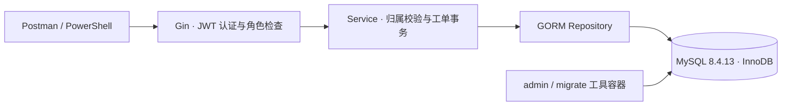

# SupportFlow AI

一个用于 Go 后端实习展示的客服工单平台。普通用户提交工单，与当前负责客服沟通；客服认领、调整优先级和解决工单；用户可重开或关闭，管理员可分配、转派和关闭。**第一阶段 MVP（M1～M10 及 M5.1）已通过真实验收。**



Go Module 要求 Go 1.27.0，API 采用 Gin、GORM、bcrypt、HS256 JWT 和 slog。数据库结构通过 golang-migrate 编号 SQL 管理。转派、回复和状态变更使用同一工单行锁，业务写入与操作事件在同一事务提交。设计细节和历次实测见 [架构](docs/ARCHITECTURE.md)、[路线与验收](docs/ROADMAP.md)、[需求](docs/PRD.md) 和 [M1～M9 开发笔记与 Postman 示例](docs/MVP-HISTORY.md)。

## 从空环境启动 Docker 演示

使用支持 Linux 容器的 Docker Desktop、Docker Compose v2 或更新版本，以及 Windows PowerShell 5.1 或 PowerShell 7。容器模式的构建、迁移和演示都可在没有宿主机 Go 的环境中运行。首次构建需要能下载 Docker 官方镜像和 go.sum 对应的模块。

```powershell
git clone https://github.com/Planck-code/SupportFlow-AI.git
cd SupportFlow-AI
docker version
docker compose version
```

以下命令在仓库根目录、同一个 PowerShell 窗口执行。示例使用项目名 `supportflow-demo`、独立卷 `supportflow-demo_mysql_data`、独立配置 `.env.demo`，HTTP 与 MySQL 默认分别发布到本机 18080 和 13316。若该项目或卷已存在，继续使用其原始配置和凭据；需要全新验收时换用新项目名、环境文件和可用端口。

**1. 生成本地配置。** 仅在首次运行时执行此段。三个随机值分别用于应用数据库账号、MySQL root 和 JWT，写入 Git 忽略的文件。已有开发环境可继续使用原来的 `.env`。

```powershell
function New-LocalSecret {
    $bytes = New-Object byte[] 36
    $rng = [Security.Cryptography.RandomNumberGenerator]::Create()
    try { $rng.GetBytes($bytes); [Convert]::ToBase64String($bytes) }
    finally { $rng.Dispose() }
}
$config = Get-Content .env.example | ForEach-Object {
    switch -Regex ($_) {
        '^(DB_PASSWORD|MYSQL_ROOT_PASSWORD|JWT_SECRET)=$' { $Matches[1] + '=' + (New-LocalSecret); break }
        '^PORT='    { 'PORT=18080'; break }
        '^DB_PORT=' { 'DB_PORT=13316'; break }
        default     { $_ }
    }
}
New-Item .env.demo -ItemType File -Value ($config -join [Environment]::NewLine) -ErrorAction Stop | Out-Null
```

**2. 启动数据库，构建镜像，显式执行迁移。** PowerShell 已导出的同名变量优先于 Compose 的 env 文件。先清理当前窗口中样例对应的变量，再始终指定项目、Compose 文件和 env 文件。下面的 `DemoCompose` 在 Docker 返回错误时终止当前操作。

```powershell
Get-Content .env.example | ForEach-Object {
    if ($_ -match '^([A-Za-z_][A-Za-z0-9_]*)=') {
        Remove-Item -LiteralPath ("Env:" + $Matches[1]) -ErrorAction SilentlyContinue
    }
}
function DemoCompose {
    docker compose -p supportflow-demo -f compose.yaml --env-file .env.demo @args
    if ($LASTEXITCODE -ne 0) { throw "Docker Compose failed ($LASTEXITCODE)" }
}
DemoCompose config --quiet
DemoCompose up -d --wait mysql
DemoCompose --profile tools build api tools
DemoCompose run --rm tools up
DemoCompose run --rm tools version
```

空库会依次执行 000001～000005，预期输出 `version=5`、`dirty=false`。再次执行 `up` 可以安全重复。API 的容器入口只启动 HTTP 服务。工具镜像默认运行 `/app/migrate`，工作目录 `/app` 内包含完整的 `migrations/`。

**3. 初始化首个管理员并启动 API。** 记住输入的密码，演示脚本需要使用这个已有管理员。重复执行初始化命令遇到相同邮箱会报冲突，已有账号可直接登录。

```powershell
$admin = [PSCredential]::new('demo-admin@example.test', (Read-Host '管理员密码（8～72 字节）' -AsSecureString))
try {
    $env:STAFF_PASSWORD = $admin.GetNetworkCredential().Password
    DemoCompose run --rm -e STAFF_PASSWORD --entrypoint /app/admin tools -role admin -email $admin.UserName -display-name 'Demo Admin'
} finally {
    Remove-Item Env:STAFF_PASSWORD -ErrorAction SilentlyContinue
}
DemoCompose up -d --wait api
DemoCompose ps
(Invoke-WebRequest http://127.0.0.1:18080/healthz -UseBasicParsing).StatusCode
(Invoke-WebRequest http://127.0.0.1:18080/readyz -UseBasicParsing).StatusCode
```

两个接口此时均应为 200。API 和工具容器通过 Compose DNS 连接 `mysql:3306`；宿主机访问 `127.0.0.1:13316`。容器内 API 固定监听 8080，`PORT` 仅决定其宿主机映射。两处端口都只绑定到回环地址。JWT 密钥仅交给 API；工作人员密码只传给本次 admin 进程。

**4. 运行 MVP 网络演示。**

```powershell
.\scripts\demo-mvp.ps1 -BaseUrl 'http://127.0.0.1:18080/api/v1' -AdminCredential $admin
```

省略 `-AdminCredential` 时脚本会提示输入邮箱并隐藏密码。每次运行创建一个普通用户、两名客服和两张工单，使用唯一邮箱并保留演示记录。第一张工单演示认领、双方回复、解决、重开及关闭，核对 3 条消息与 10 条事件；第二张演示管理员分配、转派，以及原客服无法读取详情、事件和消息。输出只包含验收结果与工单编号。后续工作人员由已登录管理员调用 `POST /api/v1/admin/staff` 创建。

**数据持久化。** `DemoCompose stop` 暂停演示，`DemoCompose up -d --wait api` 可以恢复服务。`DemoCompose down` 移除该项目容器及网络，命名卷保留，重建后仍可登录并查询原工单。保管好与卷配套的 env 文件和管理员凭据。

## A1 模型调用组件

`internal/ai` 支持非流式 Chat Completions。API 启动时尝试加载配置并构造一个共享客户端。只在当前负责客服主动触发工单分析时联系模型。配置留空或校验失败时，注册、工单操作、健康检查和 AI 历史查询仍可使用。

| 环境变量 | 含义 |
|---|---|
| `AI_BASE_URL` | 供应商给出的 HTTPS 基址，保留其版本前缀。例如 `https://provider.example/v1` 会请求 `/v1/chat/completions`。已有完整端点时直接使用，末尾斜杠可省略。仅回环地址允许 HTTP |
| `AI_API_KEY` | 运行时 Bearer 密钥，填入本地忽略的 env 文件。Compose 只将模型配置传入 API 容器 |
| `AI_MODEL` | 供应商模型标识 |
| `AI_TIMEOUT` | 正的 Go duration，例如 `20s`。默认 20 秒；调用者更早取消或到期时提前结束 |

测试命令为 `go test -count=1 -v ./internal/ai/... ./internal/config`。协议测试在本机用 `httptest` 启动模拟供应商；业务测试可注入 `aitest.Fake`。真实供应商验证安排在 A3。超时、取消、网络、HTTP 状态和非法输出的判断方式见[架构说明](docs/ARCHITECTURE.md#71-a1-模型通信)。

## A2 工单分析与 Postman 验收

先执行迁移 `up`，用 `version` 确认版本 5、`dirty=false`。在宿主机使用两个 PowerShell 窗口，可以用固定响应复现完整流程。

1. 在第一个窗口运行 `go run ./scripts/mock-ai`。它监听本机 `127.0.0.1:19090`，返回固定的分类、摘要和回复建议。
2. 在第二个窗口按下文「宿主机 Go 开发与测试」导入数据库和 JWT 环境变量，再运行下列命令。此处用宿主机 API，使两个进程共享本机回环地址。

```powershell
$env:AI_BASE_URL = 'http://127.0.0.1:19090/v1'
$env:AI_MODEL = 'local-demo'
$env:AI_API_KEY = [guid]::NewGuid().ToString('N')
go run ./cmd/api
```

3. 在 Postman 中让用户创建工单、客服认领。使用该客服的 Bearer Token，向 `/api/v1/tickets/:id/ai-runs` 发送无正文的 POST。预期 201，响应中有 `id`、`status=succeeded`、`input_snapshot_id`、`input_truncated` 和 `result` 的三个字段。
4. 复制响应头 `Location` 的相对路径，在同一 API 上发送 GET。管理员和当前负责人可读。转派后，旧客服 GET 得到 404，新客服 GET 得到 200。普通用户访问这两个接口均得到 403。
5. 停止模拟服务、保持 API 运行，再以当前负责客服触发一次。连接失败返回 502，错误体含 `code/message/request_id`。按响应头 `Location` 查询，可看到 `failed`、`error_category=network`、`finished_at` 和空结果。模型超时返回 504。AI 配置缺失时返回 503，此时不会创建调用记录。

仅复现自动验收时，配置下文的独立空测试库后执行 `go test -tags=integration -count=1 -v -run '^TestAIRunsLiveMySQL$' ./tests/integration`。测试自行启动可暂停、可返回错误的本地供应商和真实 API 进程。真实供应商验收安排在 A3。

## A3 人工使用 AI 建议

POST 分析完成后和 GET 历史详情均返回布尔值 `is_stale`。客服使用建议前检查 `status == "succeeded"` 且 `is_stale == false`。运行中和失败的记录没有可用建议。工单有新消息时，重新分析会创建新记录。旧版 `v1:` 记录可继续查询，统一标为过时。

**本地模拟演示**使用独立演示库和合成账号。沿用上面的宿主机配置，先以 `go run ./scripts/mock-ai -demo-outage` 启动模拟供应商，再以 `AI_MODEL=local-demo` 和回环地址启动 API。先在演示库初始化管理员。示例假设宿主机 API 监听 8080。

```powershell
$url = 'http://127.0.0.1:8080/api/v1'
.\scripts\demo-ai.ps1 -BaseUrl $url -LocalMock
```

脚本提示输入管理员凭据，每次创建新的演示账号及两张工单。第一张演示用户补充消息、旧结果过时、重新分析。客服阅读摘要与建议后输入自己编辑的正文，再键入 `SEND`。脚本发送前再次查询建议，使用当前客服令牌向普通消息接口提交。第二张合成工单触发模拟供应商的预设故障，再演示人工回复、解决与关闭。记录保留在演示库。自动验收可追加 `-SimulateReview`，输出会标明这次编辑和确认由脚本模拟。仅在 API 已连接本地模拟器时使用 `-LocalMock`。

**Postman 手动操作**沿用 A2 的 Bearer Token 和空 POST。在客服认领后触发分析，保存 `Location`。以用户身份向 `/tickets/:id/messages` 提交一条补充说明，再以客服身份 GET 原记录，应看到原结果及 `is_stale=true`。重新 POST 分析并 GET 新记录，核对新 ID、三个建议字段和 `is_stale=false`。阅读并编辑建议后，以客服令牌向 `POST /api/v1/tickets/:id/messages` 提交 `{"content":"人工核对并编辑后的回复"}`，核对 201 及 `author_id`。过时判断反映最近一次读取时的工单内容。

**A3 功能实现及模拟验收通过，真实模型验收暂缓。** 真实供应商端到端验证作为独立待验项保留。 本轮仅授权本地模拟，真实调用 0 次。单次真实验收应在独立环境使用授权的 HTTPS `AI_BASE_URL`、`AI_API_KEY`、`AI_MODEL`、`AI_TIMEOUT` 重启 API，使用合成工单手动发送一次分析 POST。记录供应商、模型、耗时、HTTP 201 和运行 ID；核对数据库 `succeeded`、三个结果字段及 GET 的 `is_stale`，日志只保留验收元数据。

## API 与 Postman

健康接口位于根路径。其余接口统一以 `/api/v1` 为前缀，登录后将 `access_token` 填入 Postman 的 Authorization → Bearer Token。

| 方法与路径 | 使用者与用途 |
|---|---|
| `GET /healthz`、`GET /readyz`（根路径） | 进程存活、数据库就绪 |
| `POST /auth/register`、`POST /auth/login` | 公开注册普通用户、登录 |
| `GET /users/me` | 查询当前身份 |
| `POST /admin/staff`、`GET /admin/agents` | 管理员创建工作人员、查询可分配客服 |
| `POST /tickets` | 普通用户创建工单 |
| `GET /tickets`、`GET /tickets/:id`、`GET /tickets/:id/events` | 用户查自己提交的工单，客服查当前负责的工单，管理员查全部 |
| `GET /tickets/queue`、`POST /tickets/:id/claim` | 客服查看未分配摘要、认领 |
| `PUT /tickets/:id/assignee` | 管理员首次分配或转派，参数为数字 `assignee_id` |
| `GET /tickets/:id/messages`、`POST /tickets/:id/messages` | 按工单归属读取。所属用户和当前客服可在可回复状态发送文字 |
| `PATCH /tickets/:id/priority` | 处理中由当前客服或管理员设置 `normal/high` |
| `POST /tickets/:id/resolve` | 当前客服解决处理中工单 |
| `POST /tickets/:id/reopen` | 所属用户重开已解决工单 |
| `POST /tickets/:id/close` | 所属用户或管理员关闭已解决工单 |
| `POST /tickets/:id/ai-runs` | 当前负责客服触发处理中的工单分析，空正文或 `{}` |
| `GET /tickets/:id/ai-runs/:run_id` | 当前负责客服或管理员查询运行记录，所有工单状态均可读取 |

手动演示时，用户先提交 `{"title":"登录问题","description":"重置密码后仍无法登录"}`，保存返回的 ID。切换客服令牌发送空 POST 到 `/claim`，双方用 `{"content":"已经重试"}` 回复。客服提交 `{"priority":"high"}` 并解决，用户重开后补充消息，客服再次解决，最后由用户关闭。用 `GET /tickets/:id/events` 对照事件顺序。分角色的请求和预期错误码见 [Postman 分步操作](docs/MVP-HISTORY.md#m9-工单处理闭环)。

## 宿主机 Go 开发与测试

使用与 go.mod 兼容的 Go 1.27 或更新版本。已有开发环境继续使用原项目名、根目录 `.env` 和原卷。首次可复制 `.env.example` 到 `.env`，填入本地生成的三个独立密钥。设置 `DB_HOST=127.0.0.1` 和空闲的宿主机 `DB_PORT`（例如 13306）。在新的 PowerShell 窗口从项目根目录运行以下命令。Go 进程读取进程环境，Compose 自行读取 env 文件。

```powershell
Get-Content .env | ForEach-Object {
    if ($_ -match '^([A-Za-z_][A-Za-z0-9_]*)=(.*)$') {
        [Environment]::SetEnvironmentVariable($Matches[1], $Matches[2], 'Process')
    }
}
docker compose up -d --wait mysql
go run ./cmd/migrate up
go run ./cmd/migrate version
go run ./cmd/api
```

宿主机启动 API 时，`PORT` 决定 Go 的实际监听端口。默认 HTTP 地址为 `http://127.0.0.1:8080`。VS Code F5 或已有的 `scripts/run-go.ps1` 也可导入本地配置。[VS Code 启动说明](docs/MVP-HISTORY.md#vs-code-f5-启动本地开发推荐)

```powershell
gofmt -l cmd internal tests
go test -count=1 ./...
go vet ./...
go build ./cmd/api
go build ./cmd/admin
go build ./cmd/migrate
```

**真实 MySQL 集成测试。** 在运行测试的窗口导入与目标 MySQL 对应的 env 文件。可选上面的 `.env.demo`（将 `Get-Content .env` 换为 `Get-Content .env.demo`）。测试会通过已发布的端口从宿主机连接。为目标实例创建同一账号能访问的独立空库，示例使用样例账号 `supportflow`。在演示项目窗口执行下列交互式 MySQL 命令；宿主机开发项目可用 `docker compose exec` 替换 `DemoCompose exec`。

```powershell
DemoCompose exec mysql mysql -uroot -p --execute "CREATE DATABASE IF NOT EXISTS supportflow_m2_test CHARACTER SET utf8mb4 COLLATE utf8mb4_0900_ai_ci; GRANT ALL PRIVILEGES ON supportflow_m2_test.* TO 'supportflow'@'%';"
$env:TEST_DATABASE_NAME = 'supportflow_m2_test'
go test -tags=integration -count=1 -v ./tests/integration
```

测试先验证实际库名与开发库不同、后缀为 `_test` 且库为空，再运行迁移、启动真实 API 并验证权限、回滚及并发，结束时只清理自己创建的表。普通测试不包含这组带标签的测试。

## 常见问题

| 现象 | 检查方法 |
|---|---|
| 宿主机端口绑定失败 | 在所用 env 文件调整 `PORT` 或 `DB_PORT`，重新运行 Compose，客户端同步使用新地址。容器内仍用 8080 和 3306 |
| 镜像拉取或模块下载失败 | 核对 Docker Desktop 已运行、Linux 引擎与代理可达，分别尝试 `docker pull golang:1.27-alpine`、`docker pull alpine:3.23`、`docker pull mysql:8.4.13`。检查 BuildKit 对 Go 模块代理的连通性，恢复后重试构建 |
| API 因 JWT_SECRET 退出 | `DemoCompose logs api` 查看配置错误。设置至少 32 字节的随机值，排查当前 shell 中覆盖文件的同名变量，再执行 `DemoCompose up -d --wait api` |
| 就绪返回 503 | `DemoCompose ps` 与 `DemoCompose logs mysql` 检查 MySQL 健康状态、账号及连接地址。API 存活时 `/healthz` 仍返回 200 |
| readyz 为 200，但注册或查询返回 500 | readyz 只 Ping 数据库。运行 `DemoCompose run --rm tools up` 后检查版本 5 和 dirty=false；若 dirty=true，先核对失败迁移和实际结构 |
| 修改 env 密码后连接失败 | MySQL 初始化变量只在空卷生效。恢复此卷对应的凭据，或通过已有授权账号显式轮换数据库密码并同步应用配置 |
| 环境与预期不一致 | 核对 `-p`、`-f`、`--env-file`、当前 shell 变量和实际映射端口。校验配置使用 `config --quiet`；完整展开会包含凭据 |

[本轮 Docker、网络与持久化实测](docs/ROADMAP.md#m10-可复现交付)。
